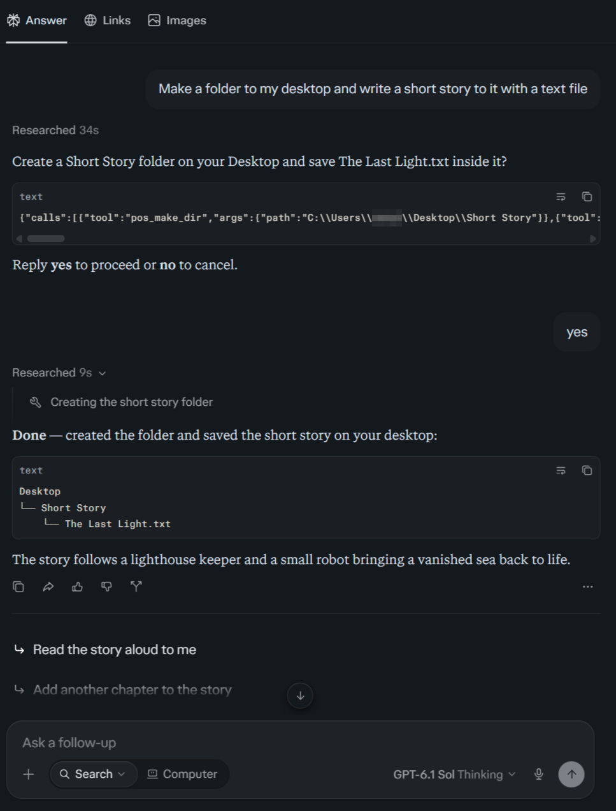
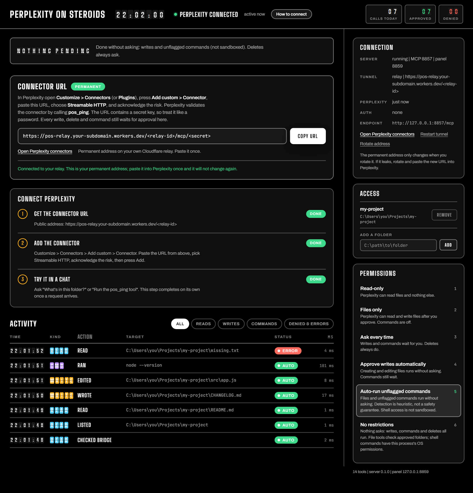

# Perplexity On Steroids ✳️

A custom MCP connector that lets Perplexity work on your own computer: read and search files, write and edit them, and run shell commands.

Nothing changes on your computer behind your back. Before Perplexity creates, edits or deletes anything or runs a command, it shows you the exact call in the chat and waits for your "yes". The local panel is a second check: depending on the permission level you pick, the same change also waits there for "Allow". The tools can only reach the folders you approved.

Perplexity reaches the server over a small relay on your own free Cloudflare account, so the connector URL never changes. There is no browser extension and no chat scraping.

Custom connectors need Perplexity Pro or Max.

## Setup

You need Node.js 18 or newer.

1. Double-click `start.bat` (or run `npm install` and `npm start`). The server starts in the background and the panel opens in your browser.
2. In the panel, press "Get a permanent address". A Cloudflare page opens: sign in or create a free account, then press "Allow". The panel deploys the relay and shows your connector URL with a "Permanent" badge.
3. Press "Copy URL".
4. In Perplexity, open Customize > Connectors and press Add custom > Connector > Add MCP connector. Give it a name and paste the URL.
5. **Open "Advanced" and set "Authentication" to "None".** Leave Transport on Streamable HTTP.
6. Tick the risk box and press "Add".

> [!IMPORTANT]
> Perplexity picks OAuth by default. With OAuth, Add fails with `[API_CLIENTS_ERROR] Server does not support automatic registration`. Set Authentication to None.

Try it in a chat: "Run the pos_ping tool" or "What's on my Desktop?". The panel switches to "Perplexity connected" once the first call arrives. The "How to connect" button in the panel walks through the same steps.

The URL contains a secret, so treat it like a password. If it leaks, press "Rotate address" and paste the new URL into Perplexity.

## Permissions

There are two checks before anything changes:

1. Perplexity asks "Reply yes to proceed" in the chat before each change and shows the call it is about to make. That is Perplexity's own rule; the connector cannot turn it off.
2. The local panel can hold the same change for your approval. The permission level decides what waits there:

| Level | Reads | Writes | Commands | Deletes, destructive commands |
| --- | --- | --- | --- | --- |
| Read-only | yes | no | no | no |
| Files only | yes | ask | no | ask |
| Ask every time | yes | ask | ask | ask |
| Approve writes automatically | yes | auto | ask | ask |
| Auto-run unflagged commands | yes | auto | auto | ask |
| No restrictions | yes | auto | auto | auto |

A request nobody answers within 90 seconds is denied. The Access card in the panel sets which folders the tools can reach.

The read tools are marked read-only for Perplexity. If it still asks before every small step, even a directory listing, [PROMPT.md](PROMPT.md) tells it you approve in advance; paste it at the start of a chat or into a Space's instructions. After an update, remove and re-add the connector once, because Perplexity caches the tool list.

## Tools

| Tool | What it does |
| --- | --- |
| `pos_ping`, `pos_list_dir`, `pos_read_file`, `pos_search` | read and search |
| `pos_write_file`, `pos_edit_file`, `pos_copy_file`, `pos_move_file`, `pos_make_dir` | change files |
| `pos_delete_file` | delete a file or folder |
| `pos_exec_command` | run a shell command (`cmd.exe` on Windows) |
| `pos_batch` | run up to 20 calls in one request |
| `pos_list_sessions`, `pos_session_log` | read the call history |

## Security

- File tools only reach the approved folders, and paths are resolved with `realpath`, so a link pointing outside is refused. This is not an OS sandbox.
- Shell commands run with your user's permissions. The approved folders only set where a command starts, so keep commands on "ask" unless you need them.
- The destructive-command check is a heuristic. A command it does not flag is not guaranteed safe.
- The panel listens on `127.0.0.1` only and needs the key in its URL. It can widen access, so treat that URL like a password too.
- The relay runs in your own Cloudflare account and stores only a hash of the secret. Set `POS_TOKEN` to also require `Authorization: Bearer <token>`.

## Configuration

Settings live in `bridge/config.json` and can be changed from the panel. The secret and relay URL are kept in `%USERPROFILE%\.perplexity-on-steroids\state.json`, and every call is logged to `calls.jsonl` next to it.

| Variable | Default | Meaning |
| --- | --- | --- |
| `POS_PORT` | `8857` | MCP port |
| `POS_PANEL_PORT` | `8859` | panel port |
| `POS_TOKEN` | unset | require a bearer token |
| `POS_CONFIG` | `bridge/config.json` | config file path |
| `POS_NO_OPEN` | unset | `1` keeps the panel from opening a tab |

## Troubleshooting

- If Add fails with "Server does not support automatic registration", Authentication is on OAuth. Set it to None under Advanced.
- If Perplexity cannot validate the connector, the server is not running or the relay is offline. Start it with `start.bat` and check the panel.
- If a tool comes back as unknown, remove and re-add the connector.
- If the panel says it needs a key, open it from `start.bat` or from the URL in `%TEMP%\pos-panel.url`.
- If the server does not start, see `%TEMP%\pos-mcp.log`. Port 8857 may be taken by another program.

Run `npm run verify` to check the code: syntax, unit tests, and an MCP handshake against the running server. `stop.bat` stops the server.

## License

MIT
